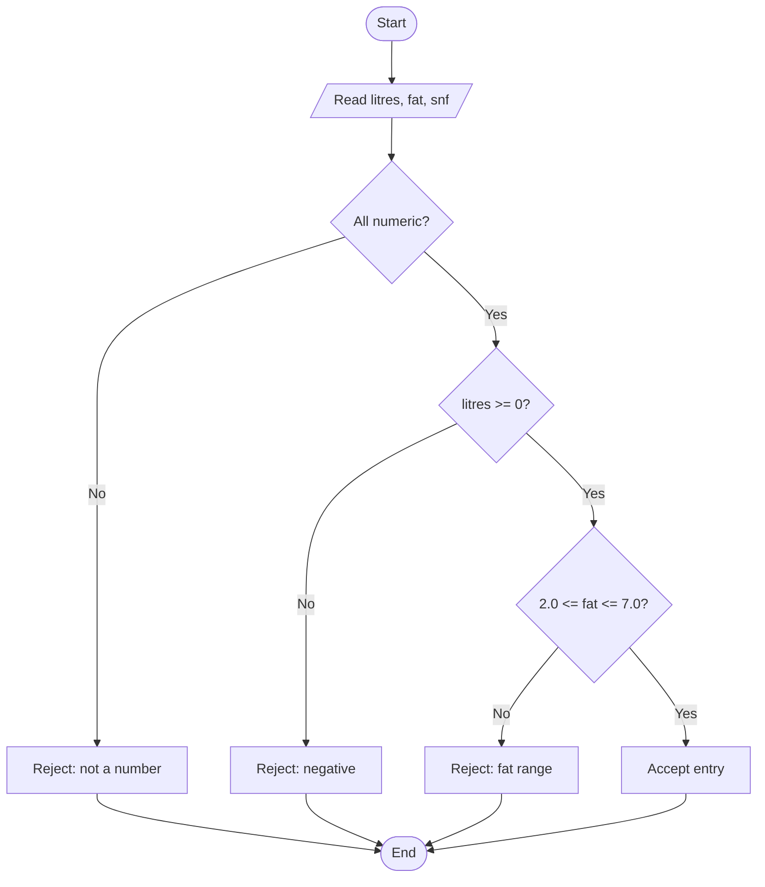

# Task 8 - Algorithm plan

**Steps:** Understand -> Plan -> Write -> Test

## Pseudocode (one entry + ten-day total)
```
ALGORITHM TenDayTotal
INPUT : entries - list of (litres, fat, snf)
OUTPUT: total   - amount payable for ten days
CONSTANTS: BASE_RATE = 30.00, FAT_STEP = 0.40, SNF_STEP = 0.30, STD_FAT = 3.5, STD_SNF = 8.5
BEGIN
    SET total <- 0
    FOR EACH (litres, fat, snf) IN entries DO
        IF litres < 0 OR fat < 2.0 OR fat > 7.0 OR snf <= 0 THEN
            DISPLAY "invalid entry"; CONTINUE
        END IF
        SET fatSteps <- ROUND((fat - STD_FAT) / 0.1)
        SET snfSteps <- ROUND((snf - STD_SNF) / 0.1)
        SET rate     <- ROUND(BASE_RATE + fatSteps*FAT_STEP + snfSteps*SNF_STEP, 2)
        SET amount   <- ROUND(litres * rate, 2)
        SET total    <- total + amount
    END FOR
    RETURN ROUND(total, 2)
END
```
> Check the exact layout against the *SIMATS Engineering - Standard for Algorithmic Pseudocode* handout and adjust keywords/format if it differs.

## Flowchart - validate one entry


## Hand trace
| Entry | fatSteps | snfSteps | rate | amount | running total |
|---|---|---|---|---|---|
| 10, 3.5, 8.5 | 0 | 0 | 30.00 | 300.00 | 300.00 |
| 8.5, 4.2, 8.7 | 7 | 2 | 33.40 | 283.90 | 583.90 |
| 12, 3.1, 8.3 | -4 | -2 | 27.80 | 333.60 | 917.50 |
